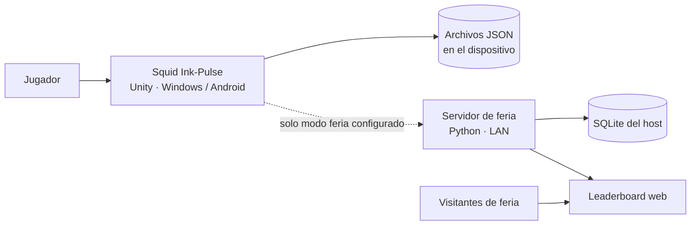
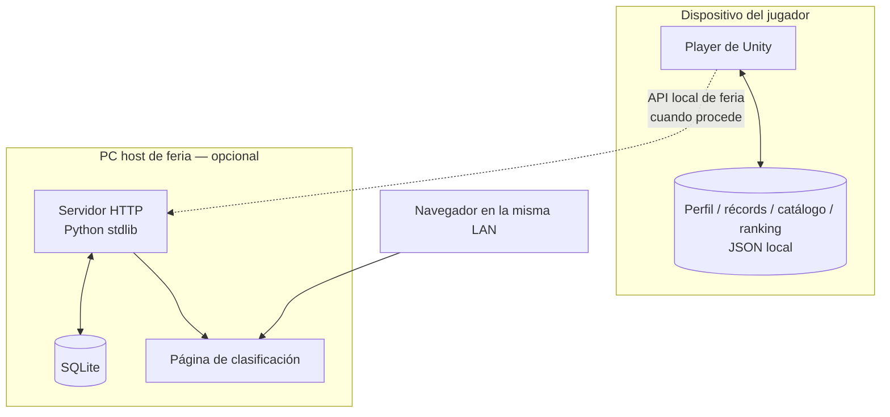
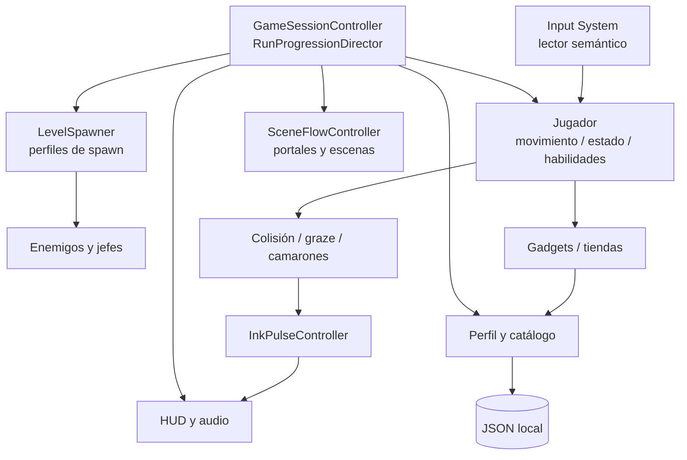
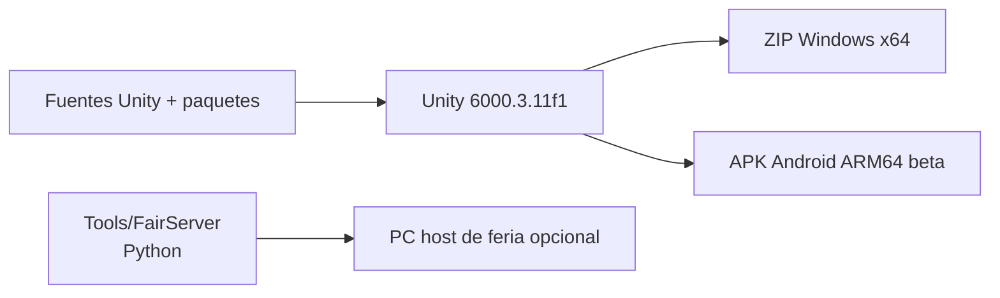

# Arquitectura del videojuego

[← Área técnica](README.md)

Documentamos la implementación que existe en el repositorio, no una arquitectura aspiracional. Unity y los componentes de sus escenas ejecutan el juego; un complemento independiente ofrece el ranking de feria.

## C1 · Contexto

La línea punteada indica una integración **opcional**. No representa una cuenta en la nube ni un servicio de guardado universal.

## C2 · Contenedores de ejecución

**Límite operativo:** la presentación validada del complemento se centra en resultados guardados desde el PC host y visualización web en otros dispositivos. La API tiene más endpoints, pero no se debe anunciar como sincronización completa de progreso multi-PC.

## C3 · Componentes principales de Unity

Este nivel representa **responsabilidades y dependencias conceptuales**, no una lista literal de llamadas entre clases. La dirección efectiva debe contrastarse con los scripts y referencias de cada prefab/escena.

## C4 · Estructura y despliegue

| Ruta | Función |
| --- | --- |
| `Assets/Scenes/` | Escenas serializadas. |
| `Assets/Implementation/Code/` | Controladores, dominio, interfaz y adaptadores Unity en C#. |
| `Assets/Implementation/Config/` | Perfiles de configuración. |
| `Assets/Content/` | Prefabs, arte, animaciones, audio. |
| `Assets/Implementation/Resources/PersistentDbSeeds/` | Semillas JSON para nuevas instalaciones. |
| `Packages/` y `ProjectSettings/` | Dependencias y configuración del editor. |
| `Tools/FairServer/` | Add-on Python/SQLite de feria. |

**Escenas activas según `ProjectSettings/EditorBuildSettings.asset`:** `MainMenu`, `ZonaEpipelagica`, `ZonaAbisopelagica`, `ShopMenu`. `ZonaTutorial` existe, pero está excluida de compilación.

La arquitectura detallada, componentes y contratos se desarrollan en [SoftwareArchitecture](../SoftwareArchitecture.md), [CoreSystems](../CoreSystems.md), [ProjectStructure](../ProjectStructure.md) y [Input](../Input.md).
