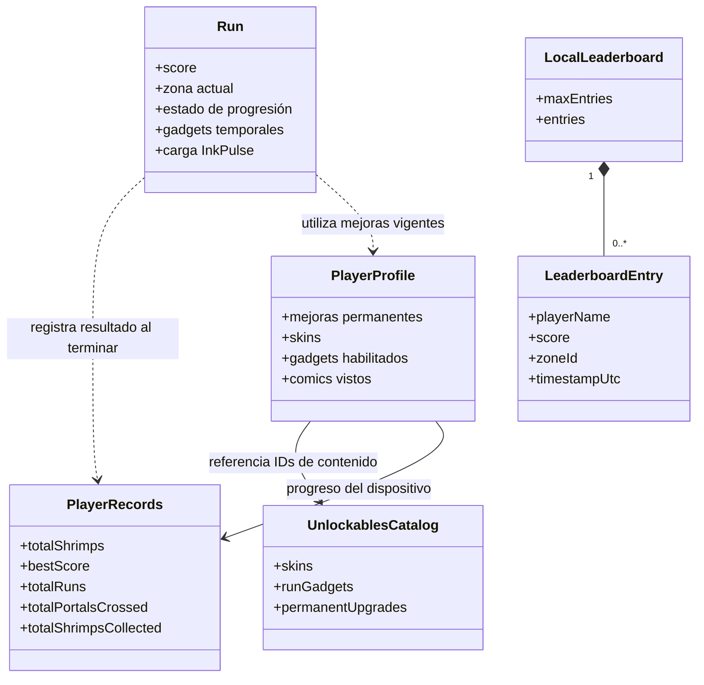
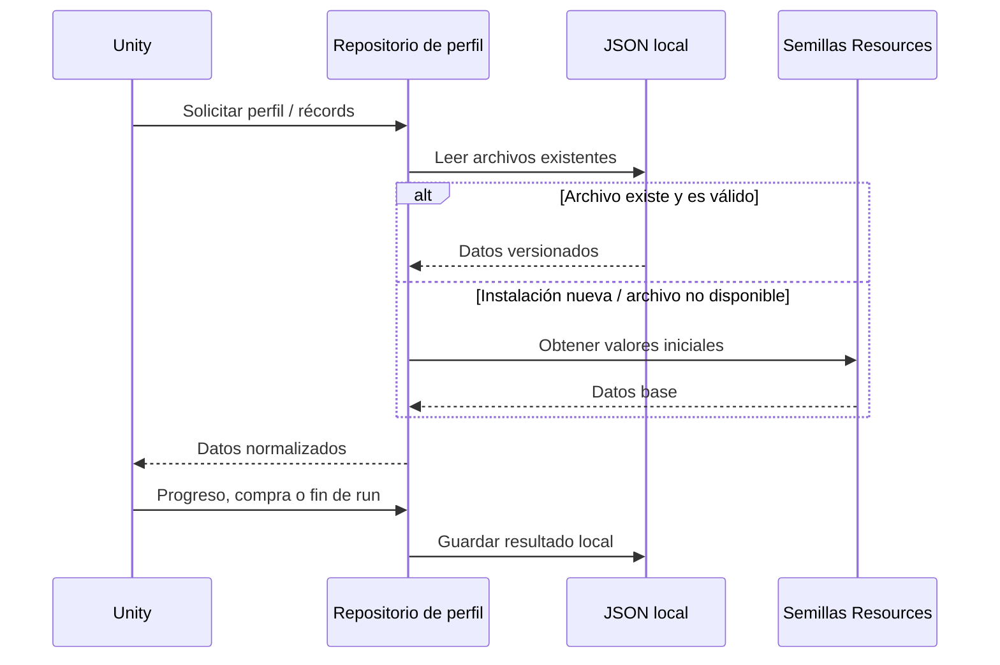
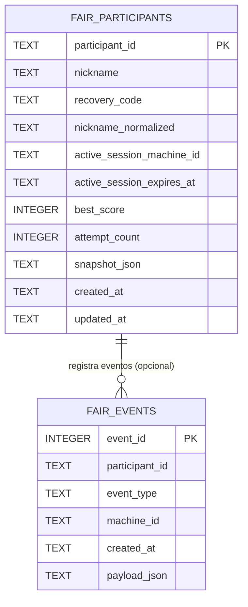

# Dominio y persistencia

[← Área técnica](README.md)

El juego mantiene el estado temporal de la partida en memoria y el progreso permanente en archivos JSON del dispositivo. El complemento de feria utiliza una base SQLite propia en el PC anfitrión.

## Modelo conceptual

Las asociaciones muestran cómo se relacionan los datos del juego. El perfil referencia el contenido mediante sus identificadores.

## Archivos persistidos

| Archivo en `Application.persistentDataPath/db/` | Propósito |
| --- | --- |
| `player-profile.json` | Niveles de mejoras, skins desbloqueadas y equipada, elegibilidad de gadgets y cómics vistos. |
| `player-records.json` | Moneda local (camarones), récord, número de partidas, portales y camarones recogidos. |
| `unlockables-catalog.json` | Definiciones y precios de contenido; usa una semilla suministrada con el juego. |
| `local-leaderboard.json` | Entradas de ranking local; no es el ranking de feria. |

Cada estructura contiene una versión y normalizaciones de datos. Las clases que definen la forma real son `PlayerProfileSaveData`, `PlayerRecordsSaveData`, `UnlockablesCatalogSaveData` y `LocalLeaderboardSaveData`.

## Flujo de lectura/escritura

La escritura atómica, recuperación y migración se detallan en [persistencia local](../PersistentProfile.md).

## Base SQLite del servidor de feria

El diagrama resume las columnas principales de [server.py](../../Tools/FairServer/server.py). La asociación es lógica: `fair_events.participant_id` admite nulos y carece de una restricción SQL de clave foránea. El archivo se guarda en `Tools/FairServer/data/fair_server.sqlite3` del host.
