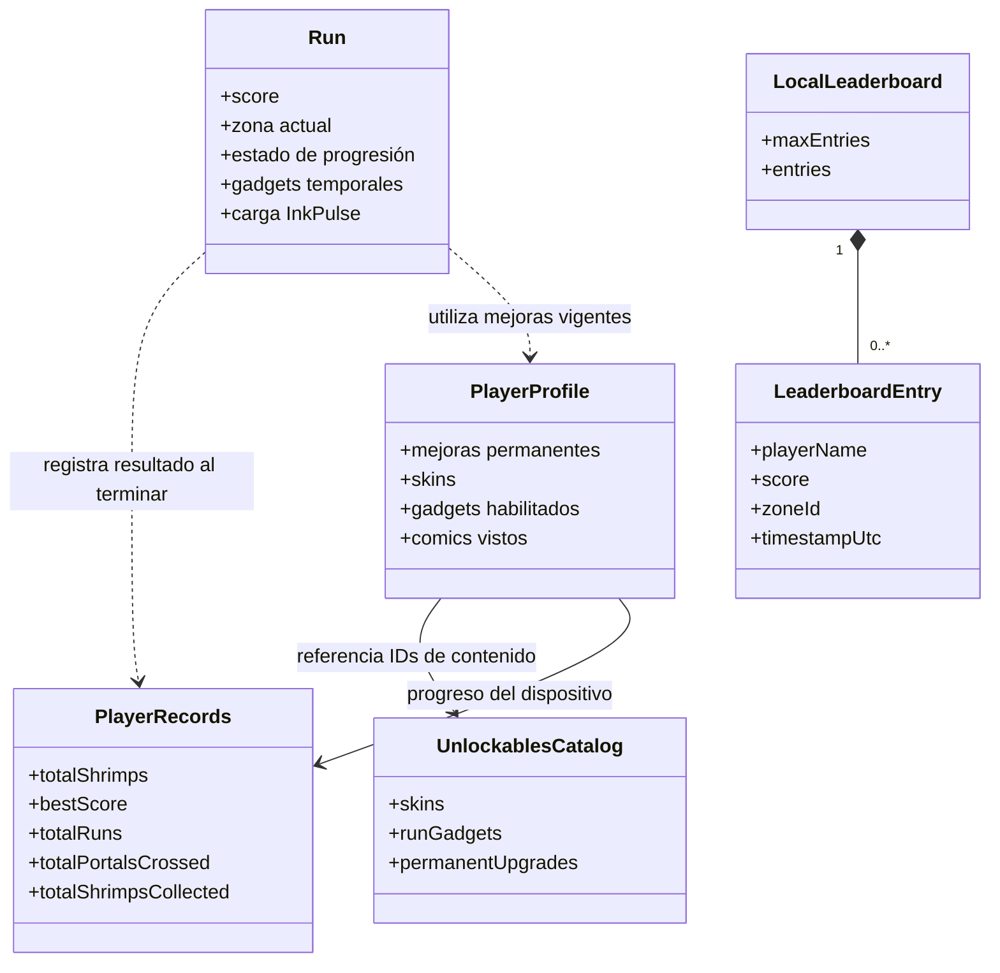
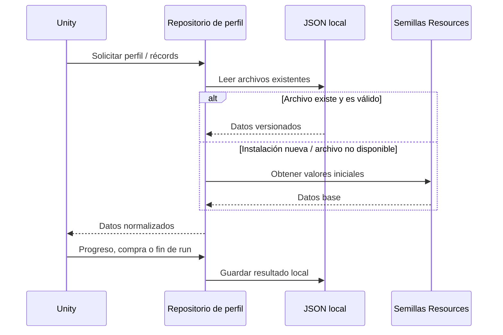
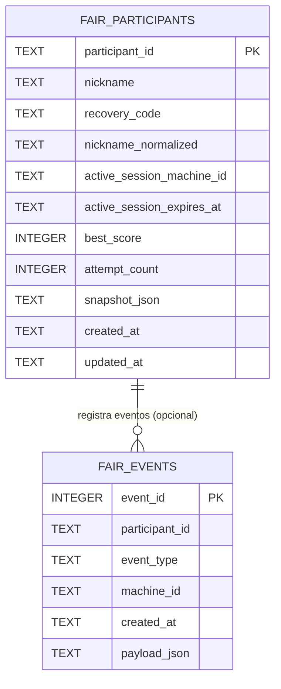

# Dominio y persistencia

[← Área técnica](README.md)

No hay una base SQL única para el juego. Separamos **datos de una partida**, **progreso permanente** y **complemento de feria**. Esta distinción evita dibujar tablas inexistentes o confundir los camarones de una partida con dinero real.

## Modelo conceptual

Las asociaciones anteriores son **conceptuales**. En los archivos JSON no se implementan claves foráneas SQL.

## Archivos persistidos

| Archivo en `Application.persistentDataPath/db/` | Propósito |
| --- | --- |
| `player-profile.json` | Niveles de mejoras, skins desbloqueadas y equipada, elegibilidad de gadgets y cómics vistos. |
| `player-records.json` | Moneda local (camarones), récord, número de partidas, portales y camarones recogidos. |
| `unlockables-catalog.json` | Definiciones y precios de contenido; usa una semilla suministrada con el juego. |
| `local-leaderboard.json` | Entradas de ranking local; no es el ranking de feria. |

Cada estructura contiene una versión y normalizaciones de datos. Las clases que definen la forma real son `PlayerProfileSaveData`, `PlayerRecordsSaveData`, `UnlockablesCatalogSaveData` y `LocalLeaderboardSaveData`.

## Flujo de lectura/escritura

La implementación exacta de escritura, restauración y migración se detalla en [PersistentProfile](../PersistentProfile.md). Este esquema es de alto nivel, no una transcripción de todas las ramas de error del repositorio.

## Base SQLite del servidor de feria

Es un **extracto de columnas relevantes** del esquema creado en `Tools/FairServer/server.py`; hay columnas adicionales que se consultan en el archivo fuente. `fair_events.participant_id` es nullable: el diagrama expresa relación lógica y **no certifica una restricción de clave foránea declarada**, ya que el SQL mostrado no la define. Los datos se almacenan en `Tools/FairServer/data/fair_server.sqlite3` del host.

No se propone un diagrama ER para los JSON locales porque **no son tablas relacionales**. Para ellos, el diagrama de clases anterior es una representación más fiel.
