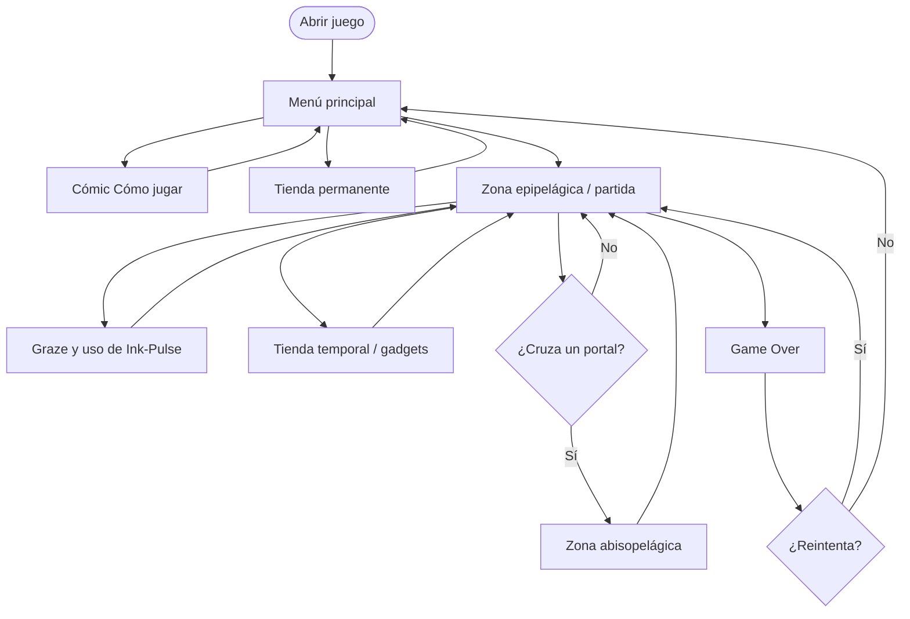
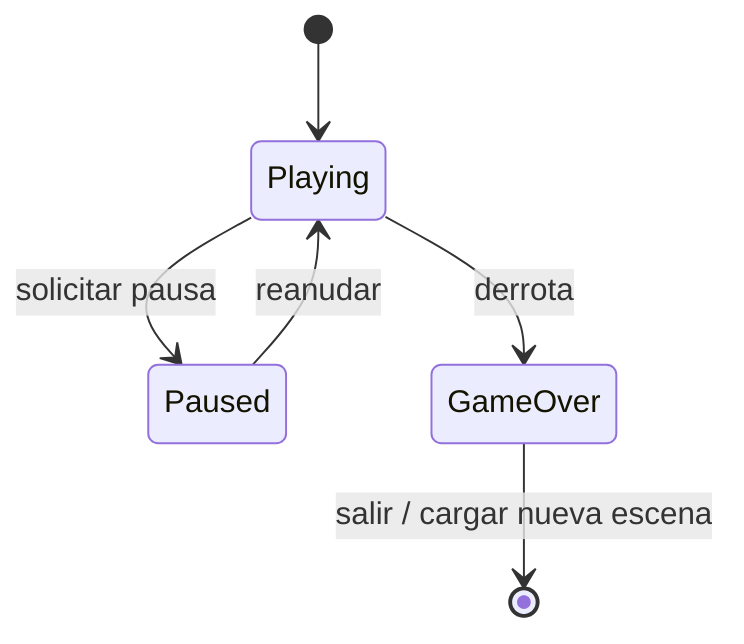
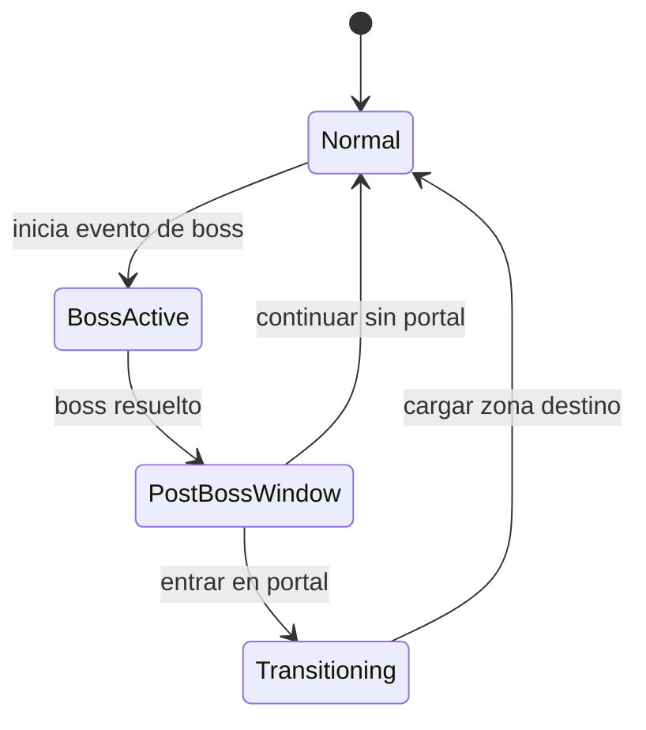
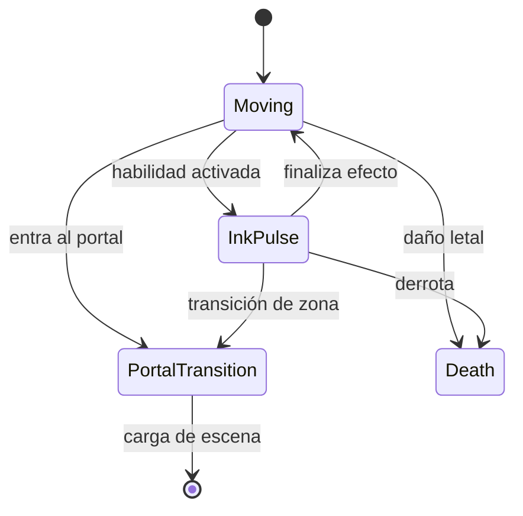
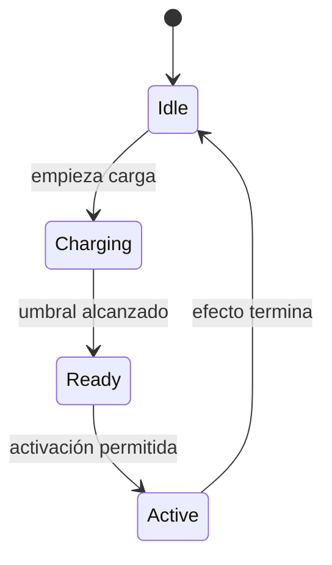

# Estados y flujos

[← Área técnica](README.md)

La sesión, el jugador, Ink-Pulse y los eventos de partida tienen estados propios. Cada controlador aplica las transiciones de su sistema.

## Flujo del jugador y escenas

Las tiendas, jefes y portales aparecen según la progresión y los perfiles de cada zona.

## Sesión global

Estados de `GameSessionState.cs`: `Playing`, `Paused`, `GameOver`.

`GameSessionController` aplica `Time.timeScale`; al entrar en GameOver registra el resultado y limpia estado temporal de la partida.

## Macroeventos de partida

Estados en `RunEventState.cs`:

`RunProgressionDirector` controla las condiciones y los tiempos de estos eventos.

## Jugador e Ink-Pulse

Los estados formales están en `PlayerRuntimeState.cs` e `InkPulseState.cs`. El graze carga Ink-Pulse al pasar cerca de una amenaza sin chocar. El controlador de la habilidad restringe su activación durante tiendas, portales y otros estados bloqueantes.

## Estados adicionales

| Subsistema | Estados formales |
| --- | --- |
| Tienda temporal | `Closed`, `Offering` |
| Cámara | `Follow`, `WideEvent`, `ReturningToFollow` |
| SS Carnage | `Inactive`, `Warning`, `DeployingNet`, `NetActive`, `Resolved`, `Failed`, `Exiting`, `Finished` |

Los efectos y las condiciones de transición se detallan en [máquinas de estado](../StateMachines.md).
