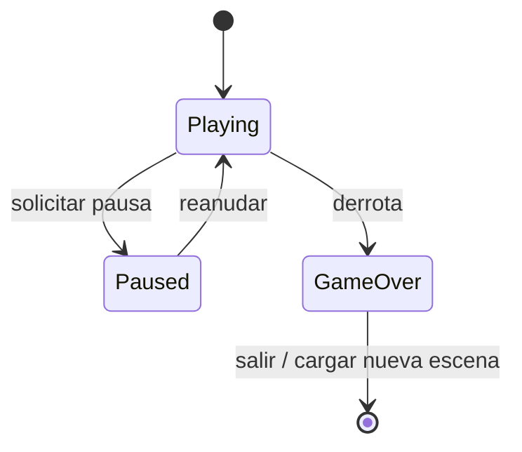
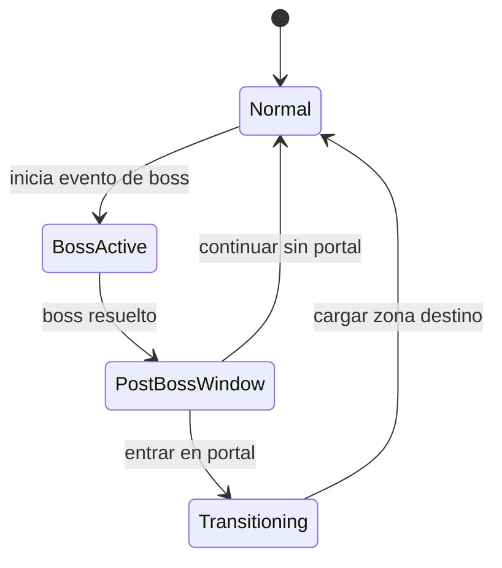
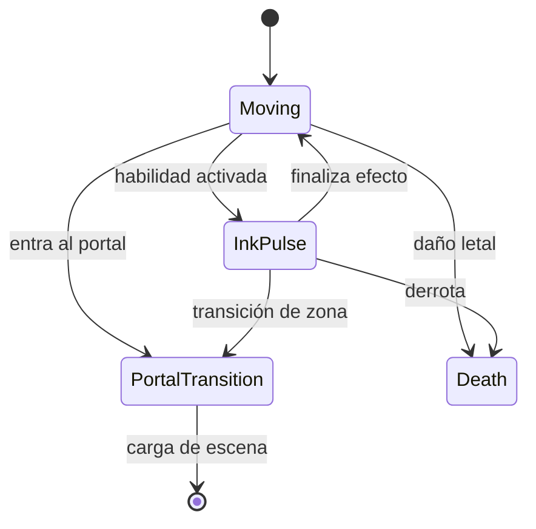
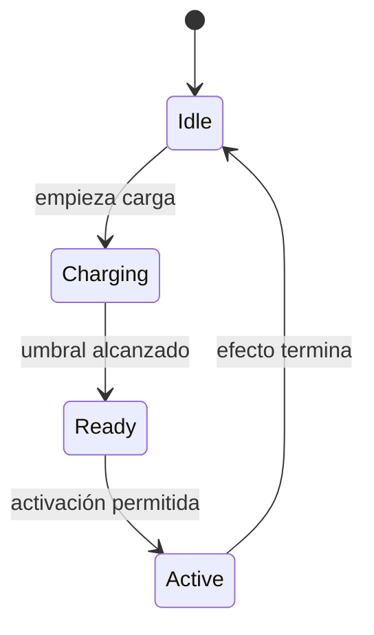

# Estados y flujos

[← Área técnica](README.md)

El juego tiene varias máquinas de estado, y cada una responde a una pregunta distinta. No conviene mezclarlas en una sola máquina gigantesca.

## Flujo del jugador y escenas

El diagrama es una **vista de navegación**; no significa que todas las tiendas o eventos estén disponibles en cualquier momento ni especifica el orden exacto de los bosses.

## Sesión global

Estados comprobados en `GameSessionState.cs`: `Playing`, `Paused`, `GameOver`.

`GameSessionController` aplica `Time.timeScale`; al entrar en GameOver registra el resultado y limpia estado temporal de la partida.

## Macroeventos de partida

Estados en `RunEventState.cs`:

Esta es una **secuencia conceptual de eventos**; revisar condiciones y tiempos exactos en `RunProgressionDirector`.

## Jugador e Ink-Pulse

Los estados formales están en `PlayerRuntimeState.cs` e `InkPulseState.cs`. El graze proporciona carga, pero **graze no equivale a colisión dañina**. El control de la habilidad aplica sus propias restricciones durante tienda, portal y otros estados.

## Estados adicionales

| Subsistema | Estados formales |
| --- | --- |
| Tienda temporal | `Closed`, `Offering` |
| Cámara | `Follow`, `WideEvent`, `ReturningToFollow` |
| SS Carnage | `Inactive`, `Warning`, `DeployingNet`, `NetActive`, `Resolved`, `Failed`, `Exiting`, `Finished` |

Los enum indican las fases **posibles**, no prueban por sí solos todas sus transiciones. Para detalles y guardas de cada sistema, consultar [StateMachines](../StateMachines.md).
