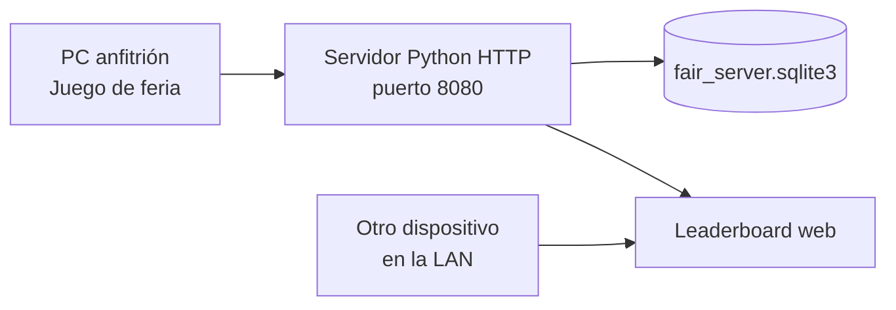
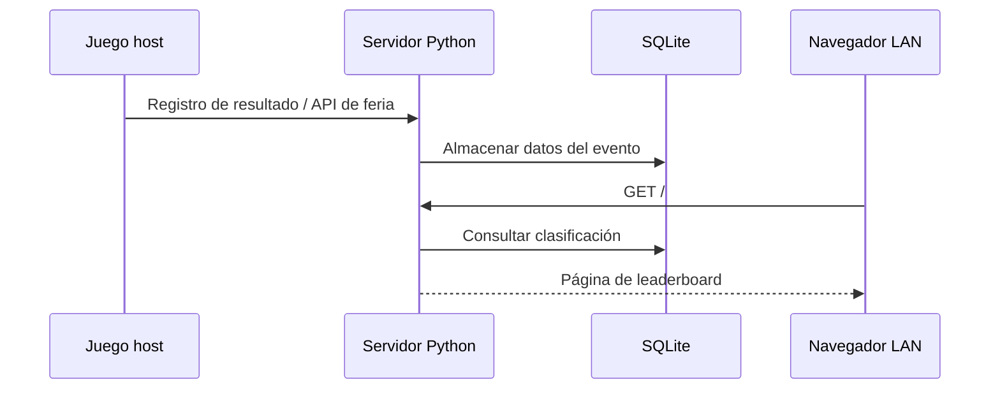

# Integración opcional · Feria

[← Área técnica](README.md)

En una feria, un PC anfitrión puede ejecutar `Tools/FairServer/server.py`, conservar una base SQLite y publicar una clasificación web visible desde la red local. **El juego normal no necesita este servidor.**

## Topología

El servidor expone rutas técnicas de participantes, recuperación, snapshots, rank, heartbeat, checkout, clasificación y health. Esas rutas existen en código, pero **no justifican afirmar que está validada una recuperación o sincronización universal entre distintos PCs**. La finalidad presentada y comprobable es el ranking del host.

## Puesta en marcha del servidor

Desde `Tools/FairServer/`, ejecutar `start_fair_server.bat` o `start_fair_server.ps1`. En el host, comprobar `http://localhost:8080/health` y visualizar `http://localhost:8080/`. Desde otro dispositivo en la misma LAN, abrir `http://IP_DEL_HOST:8080/`; no es una URL pública de Internet.

**Advertencia:** esta secuencia representa el recorrido de feria previsto para el host y no certifica escritura remota desde cualquier instalación del juego. Los detalles de los endpoints y las condiciones operativas se explican en [FairServer](../FairServer.md), [guía del evento](../FairEventSetupGuide.md) y [servidor fuente](../../Tools/FairServer/server.py).

Antes de borrar la base, cerrar el servidor y respaldar `Tools/FairServer/data/fair_server.sqlite3`. Eliminar el archivo elimina los datos almacenados en ese host.
