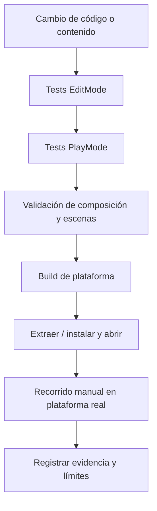

# Pruebas y validación

[← Desarrollo](README.md)

Las pruebas del repositorio comprenden clases en `Assets/Tests/EditMode/` y escenarios en `Assets/Tests/PlayMode/`. Además existen validadores de composición de escenas y reglas de build en `Assets/Implementation/Editor/`.

## Qué validar antes de una entrega

| Área | Criterio |
| --- | --- |
| Arranque | Menú visible, sin errores que impidan jugar. |
| Gameplay | Movimiento, graze, carga y activación Ink-Pulse. |
| Partida | Daño, pausa/reanudación, derrota y reintento. |
| Progresión | Camarones, gadgets, mejora permanente y persistencia tras reinicio. |
| Mundos | Portal entre zonas; conservación/restablecimiento correcto de estado. |
| UI | Menú, cómics, tiendas, opciones y HUD. |
| Windows | Build no Development, ZIP completo, extracción y arranque. |
| Android | Entrada táctil, safe areas, suspensión, rendimiento y datos tras actualización en dispositivo real. |
| Feria | Host HTTP/SQLite y visualización del ranking por LAN, si se entrega ese complemento. |

## Registro de una entrega

Anotar plataforma, versión, revisión fuente, pruebas ejecutadas y resultados junto a las notas de la entrega. Los comandos y herramientas están en [Testing](../Testing.md).

## Flujo recomendado

Detalle de comandos, suites y criterios: [Testing](../Testing.md), [SceneCompositionValidation](../SceneCompositionValidation.md), [AndroidBuild](../AndroidBuild.md) y las notas de cada [release](https://github.com/NicoCG32/Squid-Ink-Pulse-Public-Version/releases).
