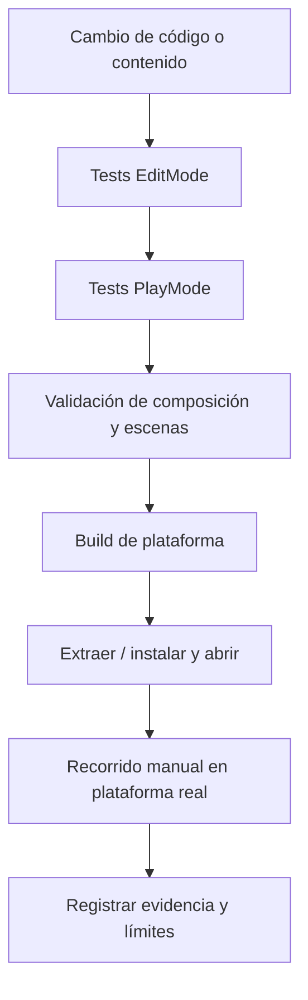

# Pruebas y validación

[← Desarrollo](README.md)

Las pruebas del repositorio comprenden clases en `Assets/Tests/EditMode/` y escenarios en `Assets/Tests/PlayMode/`. Además existen validadores de composición de escenas y reglas de build en `Assets/Implementation/Editor/`.

## Qué validar antes de una entrega

| Área | Criterio |
| --- | --- |
| Arranque | Menú visible, sin errores que impidan jugar. |
| Gameplay | Movimiento, graze, carga y activación Ink-Pulse. |
| Partida | Daño, pausa/reanudación, derrota y reintento. |
| Progresión | Camarones, gadgets, mejora permanente y persistencia tras reinicio. |
| Mundos | Portal entre zonas; conservación/restablecimiento correcto de estado. |
| UI | Menú, cómics, tiendas, opciones y HUD. |
| Windows | Build no Development, ZIP completo, extracción y arranque. |
| Android | Entrada táctil, safe areas, suspensión, rendimiento y datos tras actualización en dispositivo real. |
| Feria | Host HTTP/SQLite y visualización del ranking por LAN, si se entrega ese complemento. |

## Distinguir resultados históricos y actuales

Las notas de las releases 1.0.1 señalan **334 pruebas EditMode y 23 PlayMode** ejecutadas sobre el runtime anterior a los cambios de iconos/versionado; no fueron repetidas íntegramente para ese corte. Es correcto citarlas como evidencia previa, no afirmar que una batería nueva acaba de pasar.

Nunca sustituir los resultados por «todo probado» si no se ejecutó la matriz manual completa. Registrar plataforma, versión, revisión fuente, pruebas efectivamente realizadas, resultado y pendiente.

## Flujo recomendado

Detalle de comandos, suites y criterios: [Testing](../Testing.md), [SceneCompositionValidation](../SceneCompositionValidation.md), [AndroidBuild](../AndroidBuild.md) y las notas de cada [release](https://github.com/NicoCG32/Squid-Ink-Pulse-Public-Version/releases).
