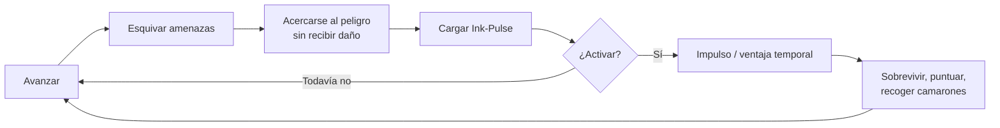
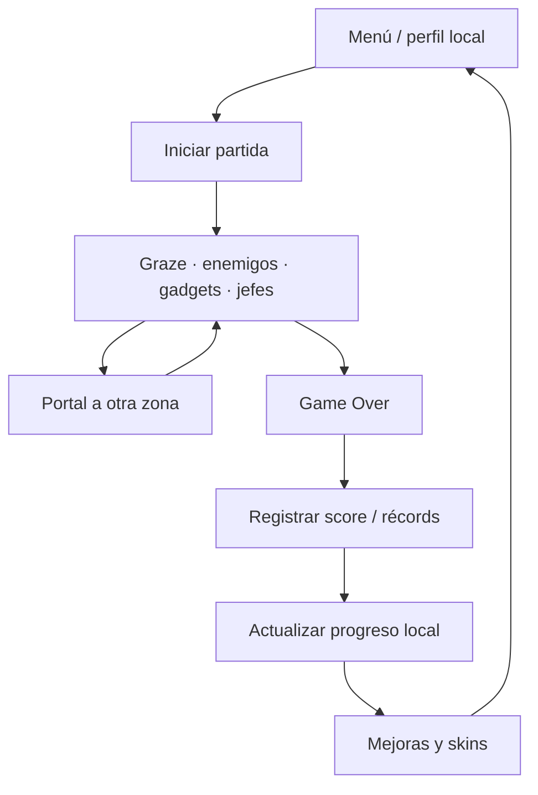

# Game Design Document · Squid Ink-Pulse

[← Diseño y experiencia](README.md)

## 1. La idea

La asignatura nos permitió elegir libremente el tipo de videojuego. Una vez conformado nuestro grupo mediante sorteo, surgieron tanto la identidad del equipo como las conversaciones sobre qué crear. **Squid Ink-Pulse fue la idea seleccionada tras una lluvia creativa de posibles videojuegos.**

Hicimos un *endless runner* submarino 2D donde controlar un pequeño calamar exige algo más que huir. Si el jugador se aproxima a los peligros sin colisionar, llena el recurso **Ink-Pulse**. Activarlo le permite atravesar una situación difícil y seguir avanzando.

La tensión central es **arriesgarse para obtener una ventaja**. Quedarse demasiado lejos es más seguro, pero puede dejar al jugador sin recurso cuando realmente lo necesite.

## 2. Pilares de diseño

| Pilar | Consecuencia jugable |
| --- | --- |
| Riesgo y recompensa | El graze (pasar cerca sin recibir daño) alimenta Ink-Pulse. |
| Lectura rápida | Obstáculos y jefes deben poder anticiparse en movimiento. |
| Rejugabilidad | Cada partida incrementa presión e introduce eventos. |
| Progreso | Moneda de camarones, gadgets, mejoras, skins y récords invitan a reintentar. |
| Identidad submarina | Zonas, animaciones, música y cómics construyen el mundo de Baby Squid. |

## 3. Bucle principal de juego

Las tiendas, los jefes y los portales modifican o interrumpen temporalmente este ciclo. No sustituye la descripción técnica de cuándo está permitido el pulso.

## 4. Mecánicas implementadas

- **Movimiento continuo** con control vertical del calamar.
- **Graze e Ink-Pulse**: proximidad segura a peligros para cargar la habilidad; activación sujeta a estado.
- **Enemigos y jefes**: patrones con perfiles de aparición y eventos especiales.
- **Progresión de run**: dificultad y ritmo de aparición cambian durante la partida.
- **Camarones**: recurso del juego para compras y mejoras; no dinero real.
- **Gadgets de partida**: entre ellos Shell Shield e Ink-Bottle; la tienda temporal los ofrece durante la run.
- **Tienda permanente**: mejoras y aspectos visuales que se conservan entre partidas.
- **Portales**: cambio entre zona epipelágica y abisopelágica, preservando el estado temporal pertinente.
- **Relato visual y audio**: cómics, efectos y música reactiva.

Los nombres de las mejoras, precios, reglas exactas y parámetros se obtienen del catálogo y scripts, no de una cifra inventada en esta guía: [GameplaySystems](../GameplaySystems.md), [EnemiesAndBosses](../EnemiesAndBosses.md), [PersistentProfile](../PersistentProfile.md).

## 5. Progreso de una partida y progreso permanente

Los gadgets de run y la carga en curso no deben confundirse con mejoras compradas permanentemente. Las reglas de reinicio dependen de `GameSessionController` y sus estados.

## 6. Alcance y límites

El jugador principal es una persona en un dispositivo local. No describimos cooperativo, online o sincronización compartida como características entregadas. La feria es un complemento separado.

El tutorial activo es un cómic en el menú. La escena de tutorial jugable existe en código, pero se mantiene fuera de las escenas de distribución.

## 7. Documentos complementarios

- [Manual del jugador](manual-del-jugador.md)
- [Zonas y amenazas](zonas-y-amenazas.md)
- [Narrativa y presentación](narrativa-y-presentacion.md)
- [Arquitectura técnica](../02-tecnica/arquitectura.md)
- [Máquinas de estado](../02-tecnica/estados-y-flujos.md)
