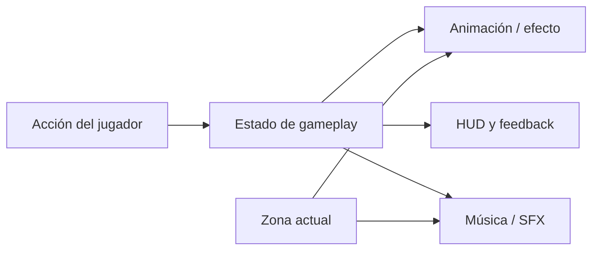

# Narrativa, identidad visual y presentación

[← Diseño y experiencia](README.md)

## Una aventura bajo el agua

El protagonista es **Baby Squid**. Su desplazamiento por entornos submarinos, el peligro creciente y los encuentros con otras criaturas construyen la atmósfera del juego. La historia se presenta mediante cómics y eventos; la documentación académica conserva cómo se describía su argumento en cada entrega del curso.

Evito convertir una interpretación del relato en un hecho nuevo: para giros narrativos, parentescos y escenas concretas, la referencia histórica es [el informe final](../reports/Informe%20Final/InformeSquidInkPulseFinal.md), y la implementación visual actual se revisa en [LoreComics](../LoreComics.md).

## Identidad y experiencia visual

- **Arte 2D y animación:** sprites y controladores animados distinguen movimiento, Ink-Pulse y tránsito de portales.
- **Interfaz:** HUD de score, camarones, carga de tinta y gadgets; menús de pausa, opciones, tienda y Game Over.
- **Zonas:** el espacio epipelágico y el abisal deben sentirse distintos; el segundo utiliza iluminación ambiental y efectos de luz.
- **Audio reactivo:** la música realiza transiciones entre la pista normal y la asociada a Ink-Pulse, con cambios de pitch según el progreso.

El gráfico representa cómo vinculamos el feedback con decisiones de juego; cada subsistema tiene su propia implementación en Unity.

## Recursos y autoría

La identidad visual del repositorio se encuentra en [branding](../../branding/README.md), con banners claro/oscuro, isotipos y variantes de icono.

**Matías Palacios** figura en los créditos como artista y compositor principal. No debe interpretarse que publicar el repositorio autoriza a reutilizar su música o sprites. Consultar los derechos y reconocimientos en [LICENSING.md](../../LICENSING.md).

Para reglas de presentación y estructura de recursos: [AnimationStandards](../AnimationStandards.md), [AssetFlow](../AssetFlow.md), [UiAndMenu](../UiAndMenu.md) y [ZoneLighting](../ZoneLighting.md).
