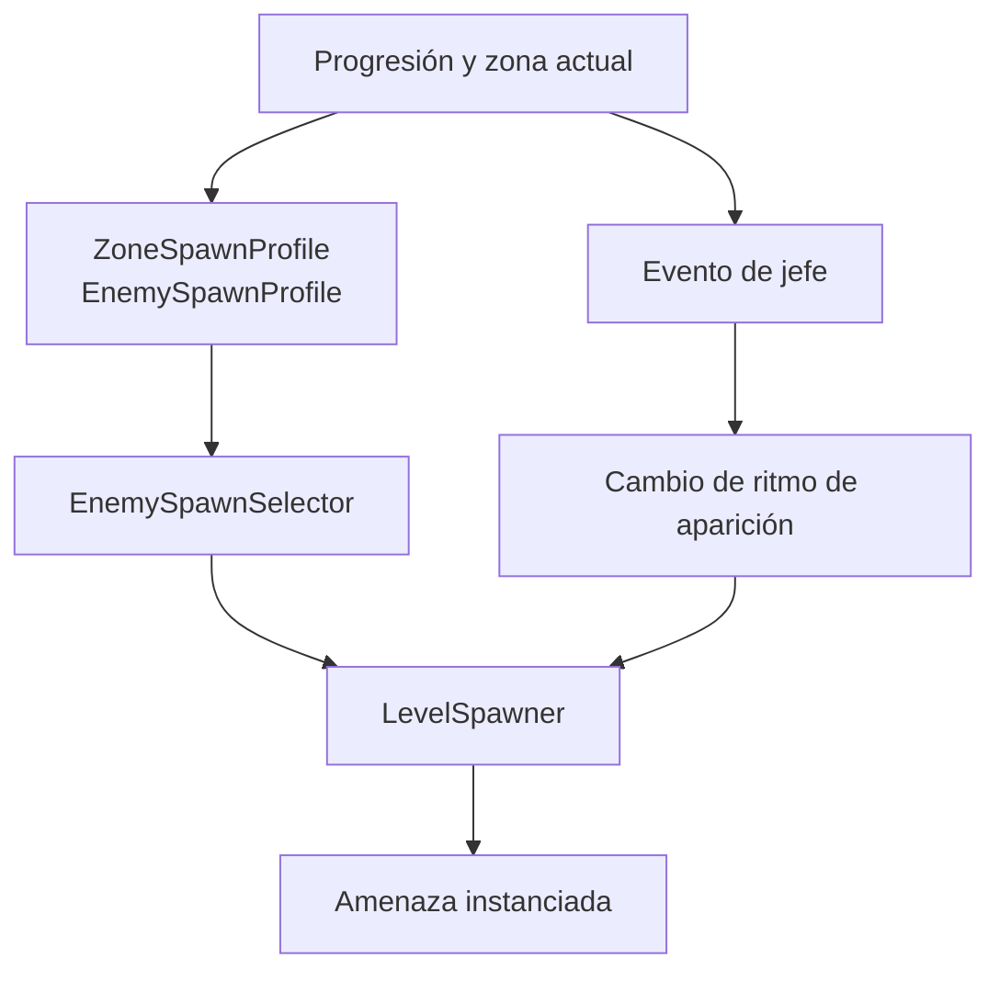

# Zonas, amenazas y progresión

[← Diseño y experiencia](README.md)

## Zonas jugables

| Zona | Descripción de juego | Escena |
| --- | --- | --- |
| **Epipelágica** | Primera zona jugable, con amenazas y el jefe **SS Carnage**. | `Assets/Scenes/Game/ZonaEpipelagica.unity` |
| **Abisopelágica** | Zona de mayor oscuridad, iluminación propia y un jefe abisal. | `Assets/Scenes/Game/ZonaAbisopelagica.unity` |

El paso mediante **portales** conecta zonas y conserva la parte correspondiente del estado de run. El juego mantiene sistemas de cámara y límites de mundo por escena; los detalles se revisan en [WorldAndCamera](../WorldAndCamera.md) y [Portals](../Portals.md).

## Amenazas

El repositorio implementa perfiles de spawn, enemigos con patrones propios y encuentros de jefes. Entre las amenazas documentadas hay **pez globo**, **mina**, **caña de pescar**, **raya** y **medusa**, además de los eventos de SS Carnage y el jefe abisal. La aparición depende de perfiles, zona, dificultad y estado de evento; no es una lista de spawn constante para cualquier momento.

Este diagrama recoge responsabilidades del sistema; para frecuencias, pesos, límites y reglas concretas consultar [EnemiesAndBosses](../EnemiesAndBosses.md).

## Eventos principales

- **SS Carnage:** encuentro específico con estados de ataque, advertencia y despliegue de red.
- **Jefe abisal:** implementación separada bajo `Bosses/UnknownBoss/FlappyBossController.cs`.
- **Tienda temporal:** presenta opciones para obtener gadgets durante la partida.
- **Portal:** una oportunidad de pasar de zona mediante una transición controlada.

Los eventos de jefe no implican detener toda aparición normal: la progresión puede aumentar la presión. El equilibrio de cada perfil es parte del contenido y puede ajustarse sin cambiar el principio de riesgo/recompensa.

## Tutorial

El tutorial disponible es el cómic del menú principal. `ZonaTutorial.unity` queda fuera de las escenas de distribución.

[Volver al GDD](gdd.md) · [Mecánicas técnicas](../GameplaySystems.md).
