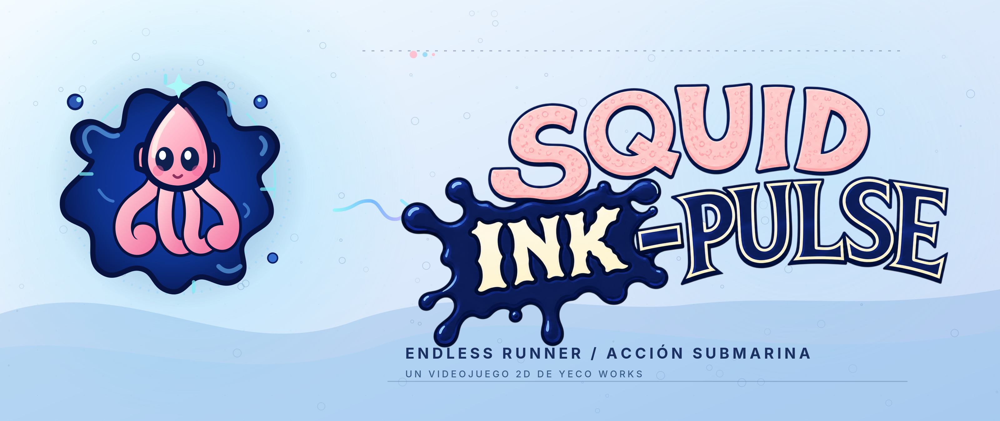

<picture>
  <source media="(prefers-color-scheme: dark)" srcset="branding/banners/squid-banner-oscuro.png">
  
</picture>

# Squid Ink-Pulse

**Acércate al peligro. Carga Ink-Pulse. Sobrevive una partida más.**

Un *endless runner* submarino 2D creado por **Yeco Works** en la Universidad Católica del Norte.

[**Descargar el juego**](https://github.com/NicoCG32/Squid-Ink-Pulse-Public-Version/releases) · [**Cómo jugar**](Docs/05-diseno-y-experiencia-de-juego/manual-del-jugador.md) · [**Documentación**](Docs/README.md) · [**Créditos y derechos**](LICENSING.md)

---

## ¿De qué trata?

En Squid Ink-Pulse controlamos a un pequeño calamar que recorre un océano lleno de amenazas. Esquivar no basta: **pasar cerca del peligro sin recibir daño** carga la habilidad Ink-Pulse. Saber cuándo arriesgarse y cuándo activar esa ventaja es el corazón del juego.

A esa mecánica sumamos enemigos, jefes, camarones como recurso, gadgets, mejoras persistentes, aspectos visuales, zonas conectadas por portales y fragmentos narrativos. La experiencia principal es **local**: no necesita una cuenta, Internet ni un servidor externo.

## Nació como un proyecto universitario

Desarrollamos el juego en grupo para **Proyecto Integrador Programación Avanzada**, asignatura del **quinto semestre de Ingeniería Civil en Computación Informática** de la **Universidad Católica del Norte**, con una carga de **5 SCT**.

El equipo Yeco Works estuvo integrado por **Pablo Guzmán, Rodrigo Cortés, Mauricio Muñoz, Inti Santibáñez y Matías Palacios**. Los roles y los derechos sobre recursos específicos se explican en [LICENSING.md](LICENSING.md). Los informes originales se mantienen íntegros en la [documentación académica](Docs/04-academica/README.md): representan el trabajo que presentamos en cada etapa, no la versión exacta de todas las actualizaciones posteriores.

## Descarga e instalación

| Plataforma | Entrega publicada | Cómo iniciar |
| --- | --- | --- |
| **Windows x64** | [v1.0.1, estable](https://github.com/NicoCG32/Squid-Ink-Pulse-Public-Version/releases/tag/windows-v1.0.1) | Descargar el ZIP del juego, descomprimirlo completo y abrir `JUGAR.cmd` o `SquidInkPulse.exe`. |
| **Android ARM64** | [v1.0.1 beta 1](https://github.com/NicoCG32/Squid-Ink-Pulse-Public-Version/releases/tag/android-v1.0.1-beta.1) | Instalar el APK. Requiere Android 7.1/API 25 o posterior; aún es beta y conserva firma de desarrollo. |

**Importante:** los archivos automáticos «Source code» de GitHub no son el juego compilado. Consulta los requisitos, límites, comprobaciones y checksums en cada release. La versión Android continúa en validación: no debe presentarse como equivalente a la estable de Windows.

### Controles de Windows

| Acción | Control |
| --- | --- |
| Dirigir al calamar | Mouse |
| Activar Ink-Pulse | Clic o Espacio |
| Pausar / reanudar | P o Escape |
| Usar gadgets | Q / W |
| Comprar en tienda durante una partida | B |

En el menú principal encontrarás **Cómo jugar**. Para Android, la entrada táctil se aborda aparte en la [guía del jugador](Docs/05-diseno-y-experiencia-de-juego/manual-del-jugador.md) y en el [estado del port](Docs/MobilePort.md).

## Tecnologías reales

| Elemento | Para qué lo usamos |
| --- | --- |
| **Unity 6000.3.11f1** y **C#** | Escenas, lógica, componentes y compilación del videojuego. |
| **Universal Render Pipeline 2D** | Renderizado, luces y efectos del mundo submarino. |
| **Unity Input System** | Contrato de entrada y lectura de comandos de gameplay; soporte táctil en desarrollo. |
| **JSON local** | Catálogos, perfil, progreso, récords y ranking por dispositivo. |
| **Python estándar y SQLite** | Servidor **opcional** de feria, con clasificación web alojada en un PC de la red local. |

El proyecto utiliza las dependencias enumeradas en [Packages/manifest.json](Packages/manifest.json). No atribuimos a este juego servicios de IA, bases de datos en la nube ni plataformas de despliegue que no pertenecen a su implementación.

## Abrir el proyecto en Unity

1. Clona o descarga el **código fuente** y abre la carpeta raíz desde Unity Hub.
2. Utiliza **Unity 6000.3.11f1** y deja que se importen las dependencias.
3. Abre `Assets/Scenes/MainMenu/MainMenu.unity` y pulsa **Play**.
4. Para generar un ejecutable, sigue [compilación y distribución](Docs/02-tecnica/compilacion-y-distribucion.md).

La escena `ZonaTutorial.unity` existe como trabajo aislado, pero **no está habilitada** en el build normal. El tutorial activo es el cómic de «Cómo jugar» del menú.

## Documentación en cinco áreas

| Área | Contenido |
| --- | --- |
| [**01 · General**](Docs/01-general/README.md) | Historia, finalidad, alcance, público y créditos. |
| [**02 · Técnica**](Docs/02-tecnica/README.md) | Arquitectura, diagramas, persistencia, estados, integraciones y plataformas. |
| [**03 · Desarrollo**](Docs/03-desarrollo/README.md) | Estructura, cambios, pruebas y criterios para mantener el proyecto. |
| [**04 · Académica y formativa**](Docs/04-academica/README.md) | Contexto del curso, entregas e informes originales. |
| [**05 · Diseño y experiencia de juego**](Docs/05-diseno-y-experiencia-de-juego/README.md) | GDD, reglas, controles, zonas, narrativa y guía para jugadores. |

[**Índice de documentación y recorridos por perfil →**](Docs/README.md)

## Un alcance que preferimos explicar bien

El juego de Windows funciona sin servidor. El complemento de feria permite mantener un ranking en un PC anfitrión y consultarlo desde navegadores de la misma LAN. Aunque existe una API técnica de participantes y snapshots, **no prometemos sincronización de progresos entre distintos equipos**: esa capacidad no forma parte del alcance oficialmente validado.

Este repositorio es público para consulta, pero **no se ha acordado una licencia general que permita reutilizar libremente el código, arte o música**. Los derechos de autor y las atribuciones se detallan en [LICENSING.md](LICENSING.md).
