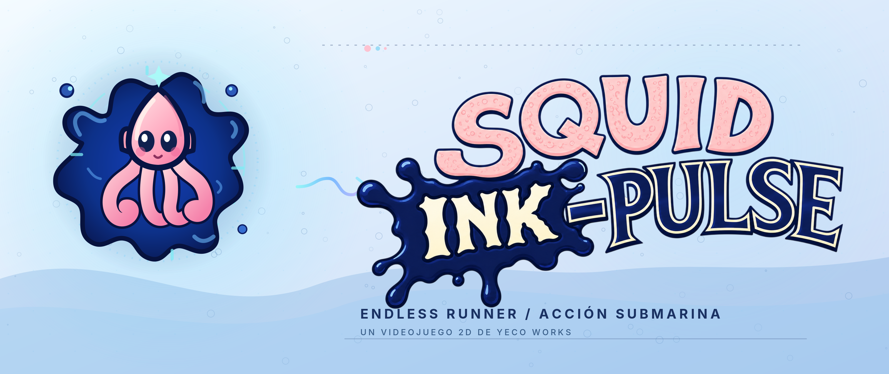

<picture>
  <source media="(prefers-color-scheme: dark)" srcset="branding/squid-banner-oscuro.png" />
  
</picture>

# Squid Ink-Pulse

**Acércate al peligro. Carga Ink-Pulse. Sobrevive una run más.**

  

   

[Releases y descargas](https://github.com/NicoCG32/Squid-Ink-Pulse-Public-Version/releases) · [Documentación](Docs/README.md) · [Arquitectura](Docs/01-arquitectura-general.md) · [Inicio rápido](#ejecutar-desde-el-código)

---

## Sobre el proyecto

Endless runner 2D submarino de Yeco Works, desarrollado en Unity. Controlas a un calamar que esquiva amenazas, recoge camarones y se acerca al peligro para cargar Ink-Pulse; incluye zonas, jefes, tiendas y progreso local.

**Estado:** Windows 1.0.0 estable y Android 1.0.0 beta 1 disponibles. El port móvil continúa en desarrollo. El juego base es local; el servidor de feria es opcional.

## Tecnologías

| Área                   | Tecnologías y responsabilidad                                      |
| ---------------------- | ------------------------------------------------------------------ |
| **Motor y gameplay**   | Unity 6000.3.11f1, C#, URP 2D y Unity Input System.                |
| **Progreso**           | Semillas JSON en Resources y guardado local en persistentDataPath. |
| **Extensión de feria** | Servidor local opcional con Python y SQLite para leaderboard LAN.  |

> **Enfoque técnico:** Juego base sin servidor obligatorio; port móvil y feria con alcance separado.

## Usar o descargar

- [Windows estable: ZIP completo](https://github.com/NicoCG32/Squid-Ink-Pulse-Public-Version/releases/tag/windows-v1.0.0): descomprime todo y abre `JUGAR.cmd`.
- [Android beta: APK ARM64 Development](https://github.com/NicoCG32/Squid-Ink-Pulse-Public-Version/releases/tag/android-v1.0.0-beta.1): consulta requisitos y SHA-256 antes de instalar.
- [Instalación, controles y límites de ambas entregas](Docs/Distribution.md). Los ZIP automáticos de código fuente no son el juego compilado.

## Ejecutar desde el código

1. Añade la raíz del repositorio a Unity Hub y ábrela con **Unity 6000.3.11f1**.
2. Espera la importación y abre [MainMenu.unity](Assets/Scenes/MainMenu/MainMenu.unity).
3. Pulsa **Play** y consulta **Cómo jugar** desde el menú.

[Build y distribución](Docs/09-instalacion-y-despliegue.md) · [Port móvil](Docs/MobilePort.md). Las releases identifican su propia revisión fuente.

## Documentación

[Índice completo y rutas de lectura](Docs/README.md) · [Instalación y controles](Docs/Distribution.md).

| Tipo                | Lectura                                                                                                                                                                          |
| ------------------- | -------------------------------------------------------------------------------------------------------------------------------------------------------------------------------- |
| General             | [Problema, cliente y solución](Docs/00-problematica-cliente-y-valor.md) · [Motivación](Docs/16-motivacion-y-contexto.md)                                                         |
| Técnica             | [Arquitectura y diagramas](Docs/01-arquitectura-general.md) · [Dominio y datos](Docs/04-base-de-datos.md)                                                                        |
| Desarrollo          | [Etapas y metodología](Docs/17-desarrollo-y-metodologia.md) · [Proyección](Docs/15-escalabilidad-y-nuevos-mercados.md) · [Costos CLP/USD](Docs/18-analisis-economico-clp-usd.md) |
| Académica/formativa | [Contexto e informes originales](Docs/academica/README.md)                                                                                                                       |

[Identidad visual](branding/README.md): logos, banners y variantes de aplicación.

## Licencia y créditos

Proyecto de Yeco Works. Licencia general de reutilización pendiente de acuerdo del equipo. [Autores, créditos y condiciones](LICENSING.md).

Menciones especiales:

- **Matías Palacios:** artista y compositor principal, autor y dueño de los soundtracks y sprites principales.
- **Rodrigo Cortés:** por su aporte a la base mecánica del juego.
- **Mauricio Muñoz:** por ser un desarrollador confiable a lo largo del proyecto.
